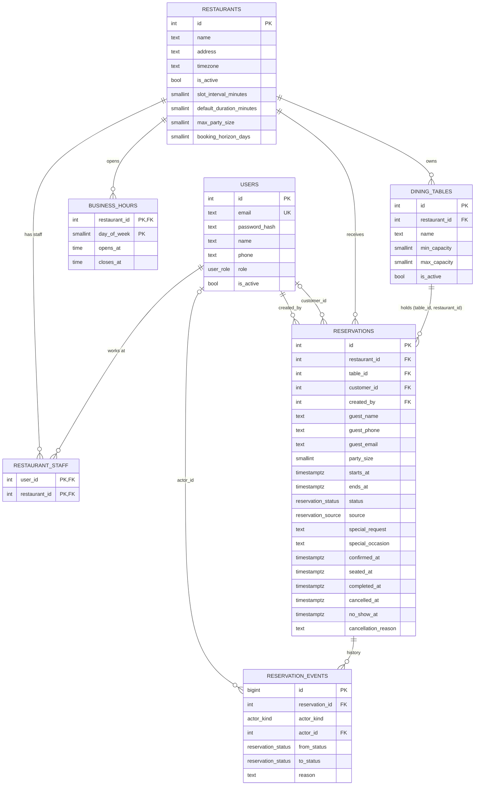

# OrangeRSVP v1 domain spec (Postgres + Drizzle)

Status: final for v1 (2026-10-06). Anything marked **Default** was chosen without a strong requirement behind it. Change it here, with a reason, before building the slice that depends on it.

v1 is done when all 8 slices in section 13 pass their tests against real Postgres, and 50 concurrent bookings for the same table and slot produce exactly 1 success and 49 clean 409s. Anything not needed for that goes in section 14.

## 1. Requirements

**Actors**

| Actor | How they are identified | Scope |
|---|---|---|
| Customer | Account, `users.role = customer` | Only bookings where `customer_id` is their id |
| Staff | Account plus a row in `restaurant_staff` | Only restaurants they are assigned to |
| Admin | Account with `users.role = admin` | Platform level |

Phone and walk-in guests without an account are not API actors. Staff create and manage their bookings.

Staff is a membership, not a value on `users.role`. A waiter at restaurant A can be a customer at restaurant B.

**Functional**
- Staff log in, pick their restaurant, and see that restaurant's reservations for a day (the day boundary uses the restaurant's timezone).
- Customers book online with an account. Staff enter phone and walk-in bookings, with or without a customer account.
- A reservation belongs to exactly one table, has a start and end time, and moves through a state machine.
- Customers can read, change (time, party size, details) and cancel their own booking before a cutoff.
- Admin creates restaurants and assigns staff. Staff manage their restaurant's tables and business hours.
- No hard deletes of reservations: DELETE becomes cancel, and history stays.

**Non-functional**
- The database must make double-booking impossible (EXCLUDE constraint), not just unlikely.
- Authorization lives in one place per resource: `*.service` calls `*.policy`. There is no separate admin folder, so there is one write path.
- All tests run against a real Postgres test database.

## 2. Decisions

| # | Decision | Why |
|---|---|---|
| D1 | One table per reservation. No combined tables in v1 | A junction table plus multi-row overlap checks come later |
| D2 | `reservations.table_id` is NOT NULL | The overlap constraint needs a resource to protect. NULLs never conflict in an EXCLUDE constraint |
| D3 | Staff pass `table_id`. For customer online bookings the server picks the smallest active table that fits and is free, in one attempt; `23P01` returns 409 "slot no longer available" (no retry loop) | Retry-with-next-table is deferred. The EXCLUDE constraint is the referee either way |
| D4 | `ends_at = starts_at + restaurants.default_duration_minutes`. The client never sends it | Clients can't hold tables longer than allowed |
| D5 | Online booking requires an account. Guest online booking (capability token) is deferred | Removes tokens, actor union and anonymous-abuse controls from v1. Adding it later is one nullable column plus one CHECK |
| D6 | Staff is a `restaurant_staff` row, no staff role column in v1 | One kind of staff means the column says nothing. Add `role` later in one migration |
| D7 | `users.role` is `customer` or `admin`, default `customer` | Signup can never create an admin. First admin comes from a seed script |
| D8 | IDs are `integer identity` | Simple and fast. Sequential ids are enumerable, so the protection is the policy check, not hidden ids |
| D9 | All times are `timestamptz` (UTC instants). `business_hours` use `time` plus the restaurant's IANA timezone | "7pm" means nothing without a zone, and DST shifts it |
| D10 | Online and phone bookings start on slot boundaries (`slot_interval_minutes`) inside business hours, within `booking_horizon_days`. Walk-ins start at `now()` and skip the slot rule | Stops 19:07 online bookings and "book for 2031". A walk-in arrives when it arrives |
| D11 | Hours past midnight are not supported (`closes_at > opens_at`) | Known limitation |
| D12 | Customer cancel cutoff is a code constant, `CANCEL_CUTOFF_MINUTES = 120` | Per-restaurant setting is a later column |
| D13 | Staff can mark `no_show` only after `starts_at + 15 minutes` | Prevents marking a no-show before the guest is late |
| D14 | **Default:** online bookings are confirmed at creation. There is no `pending` state in v1 | No staff action needed, and no stale bookings holding tables. An approval flow (large parties) adds `pending` later with `ALTER TYPE ... ADD VALUE` |
| D15 | Admin creates restaurants and assigns staff. Staff manage tables and hours of their own restaurant | Floor staff mark a table out of service mid-shift |
| D16 | Users are never hard-deleted. `is_active = false` blocks login, and the per-request actor loader rejects inactive users and revoked memberships | A JWT stays valid until it expires; the loader is what revokes access immediately |
| D17 | JWT: `sub` is `String(id)`, `expiresIn` set, algorithm pinned to HS256. Refresh tokens and blocklist come in their own later slice | Changing the database and redesigning auth in one slice makes failures ambiguous |
| D18 | Restaurant `name` is not unique | Two cities can each have a "Joe's Pizza" |
| D19 | **Default:** shortening business hours keeps existing bookings. The staff day view shows them; nothing is auto-cancelled | Cancelling guests silently is worse than a flagged booking |
| D20 | **Default:** a party-size change that no longer fits the table is rejected. Staff can change `table_id` in the same request; customers must cancel and rebook | Reassignment is the deferred auto-assign problem |

## 3. Enums

| Postgres type | Values |
|---|---|
| `user_role` | `customer`, `admin` |
| `reservation_status` | `confirmed`, `seated`, `completed`, `cancelled`, `no_show` |
| `reservation_source` | `online`, `phone`, `walk_in` |
| `actor_kind` | `user`, `system` |

Name each enum for its domain. The first argument of `pgEnum` is the database type name. Adding a value later is cheap (`ALTER TYPE ... ADD VALUE`). Removing one is not, so v1 includes only values it uses.

## 4. Tables

Every table has `created_at timestamptz NOT NULL DEFAULT now()`. Tables whose rows are edited also have `updated_at` with the same type and default. Drizzle's `$onUpdate` only runs in the app, so raw SQL updates don't bump `updated_at` (a trigger fixes that later).

### 4.1 `users`

| Column | Type | Constraints |
|---|---|---|
| id | integer identity | PK |
| email | text | NOT NULL, UNIQUE, `CHECK (email = lower(email))`. Zod lowercases and trims; the CHECK catches every path that skips Zod |
| password_hash | text | NOT NULL. Never selected outside login |
| name | text | NOT NULL |
| phone | text | NULL. E.164 when present |
| role | user_role | NOT NULL DEFAULT `customer` |
| is_active | boolean | NOT NULL DEFAULT true |
| created_at, updated_at | timestamptz | NOT NULL DEFAULT now() |

### 4.2 `restaurants`

| Column | Type | Constraints |
|---|---|---|
| id | integer identity | PK |
| name | text | NOT NULL |
| address | text | NOT NULL |
| timezone | text | NOT NULL. IANA name, validated in Zod against `Intl.supportedValuesOf("timeZone")` |
| is_active | boolean | NOT NULL DEFAULT true. Inactive restaurants take no new bookings |
| slot_interval_minutes | smallint | NOT NULL DEFAULT 15, CHECK > 0 |
| default_duration_minutes | smallint | NOT NULL DEFAULT 90, CHECK > 0 |
| max_party_size | smallint | NOT NULL DEFAULT 8, CHECK >= 1 |
| booking_horizon_days | smallint | NOT NULL DEFAULT 30, CHECK > 0 |
| created_at, updated_at | timestamptz | NOT NULL DEFAULT now() |

### 4.3 `business_hours`

| Column | Type | Constraints |
|---|---|---|
| restaurant_id | integer | NOT NULL, FK to restaurants, ON DELETE CASCADE (the rows are owned by the restaurant) |
| day_of_week | smallint | NOT NULL, CHECK BETWEEN 0 AND 6 (0 = Sunday, matches `EXTRACT(DOW ...)`) |
| opens_at | time | NOT NULL |
| closes_at | time | NOT NULL, CHECK `closes_at > opens_at` |
| created_at, updated_at | timestamptz | NOT NULL DEFAULT now() |

PK `(restaurant_id, day_of_week)`. A closed day has no row.

### 4.4 `restaurant_staff`

| Column | Type | Constraints |
|---|---|---|
| user_id | integer | NOT NULL, FK to users, ON DELETE CASCADE |
| restaurant_id | integer | NOT NULL, FK to restaurants, ON DELETE CASCADE |
| created_at | timestamptz | NOT NULL DEFAULT now() |

PK `(user_id, restaurant_id)`. Extra index on `restaurant_id` (the PK index starts with `user_id`, so "staff of this restaurant" can't use it).

### 4.5 `dining_tables`

Named this way because `table` is a reserved word and a `tables` variable reads like "all tables".

| Column | Type | Constraints |
|---|---|---|
| id | integer identity | PK |
| restaurant_id | integer | NOT NULL, FK to restaurants, ON DELETE RESTRICT |
| name | text | NOT NULL |
| min_capacity | smallint | NOT NULL, CHECK >= 1 |
| max_capacity | smallint | NOT NULL, CHECK >= min_capacity |
| is_active | boolean | NOT NULL DEFAULT true (out of service) |
| created_at, updated_at | timestamptz | NOT NULL DEFAULT now() |

- `UNIQUE (restaurant_id, name)`: no two "T12" in one restaurant. Also indexes `restaurant_id`.
- `UNIQUE (id, restaurant_id)`: looks redundant, but it is the required target of the composite FK in `reservations`. Without it the migration fails with "there is no unique constraint matching given keys".
- "Reserved" and "occupied" are derived from reservations, never stored.

### 4.6 `reservations`

| Column | Type | Constraints |
|---|---|---|
| id | integer identity | PK |
| restaurant_id | integer | NOT NULL, FK to restaurants, RESTRICT |
| table_id | integer | NOT NULL (composite FK below) |
| customer_id | integer | NULL, FK to users, RESTRICT. Whose booking it is. NULL for phone and walk-in guests without an account |
| created_by | integer | NOT NULL, FK to users, RESTRICT. Who entered it (the customer, or staff) |
| guest_name | text | NOT NULL. Who is showing up |
| guest_phone | text | NOT NULL. E.164, normalized in Zod |
| guest_email | text | NULL |
| party_size | smallint | NOT NULL, CHECK > 0 |
| starts_at | timestamptz | NOT NULL |
| ends_at | timestamptz | NOT NULL, CHECK `ends_at > starts_at` |
| status | reservation_status | NOT NULL. No default: the service sets it from the source (section 9) |
| source | reservation_source | NOT NULL |
| special_request | text | NULL |
| special_occasion | text | NULL |
| confirmed_at, seated_at, completed_at, cancelled_at, no_show_at | timestamptz | NULL. Set by the matching transition |
| cancellation_reason | text | NULL |
| created_at, updated_at | timestamptz | NOT NULL DEFAULT now() |

**Composite FK** `(table_id, restaurant_id)` references `dining_tables (id, restaurant_id)` ON DELETE RESTRICT. This is the integrity guarantee: without it a booking could name restaurant 1 and point at restaurant 2's table. (The plain `restaurant_id` FK is then technically redundant but harmless.)

Table-level CHECKs:
- `status <> 'confirmed' OR confirmed_at IS NOT NULL`, and the same shape for `seated`, `completed`, `cancelled`, `no_show`
- `source <> 'online' OR customer_id IS NOT NULL` (online bookings always belong to an account)

Indexes: `(restaurant_id, starts_at)` for the staff day view, `(customer_id, starts_at)` for "my reservations".

Exclusion constraint (slice 8, custom SQL migration via `drizzle-kit generate --custom`; `btree_gist` is a trusted extension on Postgres 13+):

```sql
EXCLUDE USING gist (table_id WITH =, tstzrange(starts_at, ends_at) WITH &&)
  WHERE (status IN ('confirmed', 'seated'))
```

Completed, cancelled and no-show bookings free the table. `tstzrange` defaults to `[)` bounds, so back-to-back bookings (19:00-20:30, 20:30-22:00) don't conflict. Violation code is `23P01`.

### 4.7 `reservation_events` (append-only history)

| Column | Type | Constraints |
|---|---|---|
| id | bigint identity | PK. Append-only tables grow fastest |
| reservation_id | integer | NOT NULL, FK to reservations, ON DELETE RESTRICT |
| actor_kind | actor_kind | NOT NULL |
| actor_id | integer | NULL, FK to users |
| from_status | reservation_status | NULL on creation |
| to_status | reservation_status | NOT NULL |
| reason | text | NULL |
| created_at | timestamptz | NOT NULL DEFAULT now() |

CHECK `(actor_kind = 'user') = (actor_id IS NOT NULL)`: a user event names the user, a system event names nobody.

Index `(reservation_id, created_at)`. The status change and the event insert run in one transaction. The timestamp columns on `reservations` answer "when?" quickly. The events table answers "who changed what, from which state?".

## 5. Cardinality

| Pair | Relation | FK on | Why |
|---|---|---|---|
| users and restaurants | N:M | `restaurant_staff` | A user can work at several restaurants, a restaurant has several staff |
| restaurants and business_hours | 1:N | `business_hours.restaurant_id` | Child holds the FK |
| restaurants and dining_tables | 1:N | `dining_tables.restaurant_id` | Same |
| restaurants and reservations | 1:N | `reservations.restaurant_id` | Redundant on purpose for fast queries and policy checks. The composite FK keeps it consistent |
| dining_tables and reservations | 1:N | `reservations.(table_id, restaurant_id)` | One table per booking, composite FK |
| users and reservations (customer) | 1:N, optional | `reservations.customer_id` | Phone and walk-in guests may have no account |
| users and reservations (creator) | 1:N | `reservations.created_by` | Every booking is entered by a logged-in user |
| reservations and reservation_events | 1:N | `reservation_events.reservation_id` | History |
| users and reservation_events | 1:N, optional | `reservation_events.actor_id` | System actions have no user |
| all other pairs | none | | |

## 6. Diagram



Every table also has `created_at`, and the editable ones have `updated_at`.

## 7. Features (code folders) and tables

| Feature | Owns tables | Notes |
|---|---|---|
| `auth` | none (reads `users`) | Login, token signing, later refresh and blocklist in Redis |
| `users` | `users` | Public signup always creates `customer` |
| `restaurants` | `restaurants`, `business_hours`, `restaurant_staff` | Restaurant plus hours is one transaction. Admin-only routes sit here behind the admin check |
| `tables` | `dining_tables` | Staff of the restaurant manage them |
| `reservations` | `reservations`, `reservation_events` | The state machine and overlap live here |

No `admin` folder: admin endpoints live in the feature that owns the resource, and the policy lets admin through.

Route sketch:
- `POST /users`, `POST /login`
- `POST /restaurants` (admin), `GET /restaurants`, `GET /restaurants/:id`, `PUT /restaurants/:id/hours`, `POST /restaurants/:id/staff` (admin), `DELETE /restaurants/:id/staff/:userId` (admin)
- `GET /restaurants/:id/tables`, `POST /restaurants/:id/tables`, `PATCH /tables/:id`
- `POST /reservations`, `GET /reservations?restaurantId=&date=` (staff), `GET /reservations/mine` (customer), `GET /reservations/:id`
- `PATCH /reservations/:id` (time, party size; table for staff), `PATCH /reservations/:id/details`
- `POST /reservations/:id/seat|complete|no-show|cancel`

Status is never accepted in a body. Every change is a named action.

## 8. Permission matrix

Cell values: yes, no, or a condition. Admin passes every policy.

| Action | Customer | Staff of this restaurant | Admin |
|---|---|---|---|
| Sign up | public | public | no (seed script) |
| Browse restaurants, hours | public | public | public |
| Create restaurant, edit its settings | no | no | yes |
| Add or remove staff | no | no | yes |
| Edit business hours | no | yes | yes |
| Create, edit, deactivate tables | no | yes | yes |
| Create online reservation (for themselves) | yes | yes, as a customer | yes |
| Create phone or walk-in reservation | no | yes | yes |
| Read one reservation | own | this restaurant | yes |
| List a restaurant's reservations by day | no | this restaurant | yes |
| List my reservations | own | own | own |
| Change time or party size | own, `confirmed`, before cutoff | `confirmed` | yes |
| Change table | no | `confirmed` or `seated` | yes |
| Edit guest details, special request | own, `confirmed`, before cutoff | `confirmed` or `seated` | yes |
| Cancel | own, `confirmed`, before cutoff | `confirmed` | yes |
| Seat, complete | no | yes | yes |
| No-show | no | after `starts_at` + 15 min | yes |
| Read reservation events | no | this restaurant | yes |

Every cell with a condition becomes a function in a `*.policy.ts`. Cutoff and no-show rules need `now`, which comes from `buildContext`, never from inside the policy.

## 9. Reservation state machine

| From | To | Who | Timestamp set |
|---|---|---|---|
| (new, online) | `confirmed` | customer | `confirmed_at` |
| (new, phone) | `confirmed` | staff | `confirmed_at` |
| (new, walk_in) | `seated` | staff | `seated_at` (`starts_at = now()`) |
| `confirmed` | `cancelled` | owner before cutoff, or staff | `cancelled_at` |
| `confirmed` | `seated` | staff | `seated_at` |
| `confirmed` | `no_show` | staff, after `starts_at` + 15 min | `no_show_at` |
| `seated` | `completed` | staff | `completed_at` |

Terminal: `completed`, `cancelled`, `no_show`. Each transition is one conditional `UPDATE ... WHERE id = $1 AND status = $from RETURNING`, plus an event insert, in one transaction. Zero rows returned: re-select; missing means 404, otherwise 409.

## 10. Rules: database vs service

| Entity | Database enforces | Service enforces |
|---|---|---|
| users | UNIQUE email, CHECK lowercase, NOT NULL columns, enum role | Password strength, hash |
| restaurants | NOT NULL, CHECK on the four numeric settings | Valid IANA timezone |
| business_hours | PK (restaurant, day), CHECK day 0-6, CHECK closes after opens, FK cascade | Written with the restaurant in one transaction |
| restaurant_staff | PK (user, restaurant), FKs | Only admin may write |
| dining_tables | UNIQUE (restaurant, name), UNIQUE (id, restaurant), CHECK capacity range, FK RESTRICT | Can't deactivate a table with future active reservations (see concurrency below) |
| reservations | Composite FK, CHECKs above, EXCLUDE, FKs, enums | Restaurant active, table active, party size fits table capacity and restaurant max, slot boundary inside business hours (not walk-ins), within the horizon, `ends_at` computed, allowed transition, cutoff |
| reservation_events | FKs, NOT NULL `to_status`, actor CHECK | Written in the same transaction as the status change |

**Concurrency rules (check-then-act races):**
- Deactivating a table and booking it must serialize on the same row. Deactivate: `SELECT ... FROM dining_tables WHERE id = $1 FOR UPDATE`, check for future active reservations, update. Booking: read the table `FOR SHARE` and check `is_active` under that lock, then insert. Both run inside a transaction.
- Overlapping bookings: no application check is trusted. EXCLUDE decides; `23P01` maps to 409.
- Transitions: the conditional `UPDATE ... WHERE status = $from` decides. Never read the status, then write.

**Staff day view:** the local day is `[local midnight, next local midnight)` converted to UTC with the restaurant's timezone. It can be 23 or 25 hours long on DST days, so never compute it as `midnight + 24h`.

## 11. Error mapping (central handler)

Drizzle wraps pg errors, so read `err.cause.code`.

| Source | Code | Response |
|---|---|---|
| Zod | none | 400 |
| `HttpError` subclasses | none | their own status |
| NOT NULL, invalid text representation, CHECK | `23502`, `22P02`, `23514` | 400 |
| Unique violation | `23505` | 409 |
| Foreign key violation | `23503` | 409 by default. Create services that receive a parent id catch it and throw `ItemNotFoundError` (404), because there it means the parent doesn't exist |
| Exclusion violation | `23P01` | 409 (slot taken) |
| Deadlock | `40P01` | Retry the transaction a limited number of times, then 409. (`40001` serialization failures only happen under `REPEATABLE READ` / `SERIALIZABLE`, which v1 doesn't use) |
| Anything else | none | Log the real error, return 500 with no internals |

## 12. Known gaps (written down on purpose)

- Guests overstaying: `seated` past `ends_at` frees the table on paper while it is still occupied. Fix later: extend `ends_at` on overstay.
- Hours past midnight, date-specific closures, split lunch/dinner windows.
- Per-party-size turn times, per-restaurant cancel cutoff.
- No booking caps per customer; the global rate limiter is the only abuse control.
- `updated_at` is set by the app only.

## 13. Build order

Each slice: schema, generate, read the SQL, migrate, service, policy, routes, tests, hit every endpoint once, `npm run typecheck`.

1. **Infra:** fix `tsconfig` so `tsc` runs, `drizzle-orm` + `pg` + `drizzle-kit`, `db.ts`, `POSTGRES_URL` in the Zod env, a dedicated DB role, a test database with truncate between tests, `fileParallelism: false`.
2. **`users` and `auth`:** signup creates customers only, seed script for the first admin, JWT `sub` and expiry, HS256 pinned.
3. **`restaurants` and `business_hours`:** first transaction, first LEFT JOIN and reshape.
4. **`restaurant_staff`** and the loader that fetches the actor (active check) and their memberships per request.
5. **`dining_tables`:** composite UNIQUEs, deactivate with `FOR UPDATE`.
6. **`reservations` basics:** staff create phone and walk-in bookings with a given `table_id`, list by day (timezone), read one, "my reservations".
7. **Transitions and `reservation_events`:** conditional updates and the event insert in one transaction, policies with `buildContext({ now })`.
8. **EXCLUDE constraint**, the 50-concurrent-bookings test, and customer online booking (server picks the smallest free fitting table, one attempt, `23P01` → 409).

## 14. Deferred (after v1)

- Guest online booking: `guest_token_hash` (sha256, UNIQUE, NULL) plus CHECK, actor union (JWT or `X-Guest-Token` header), token sent in a header and never in the URL path, `actor_kind` gains `guest`.
- Abuse controls for anonymous booking: rate limit per IP and phone, active-booking cap per phone (`pg_advisory_xact_lock`), phone OTP, card holds.
- Auto table assignment with retry on `23P01`; combined tables (junction table).
- `pending` state and an approval flow for large parties.
- Staff roles on `restaurant_staff` (`manager`, `foh`, `kitchen`), the first step toward the Restaurant OS.
- Refresh tokens and blocklist (ported from AdvancedJWT).
